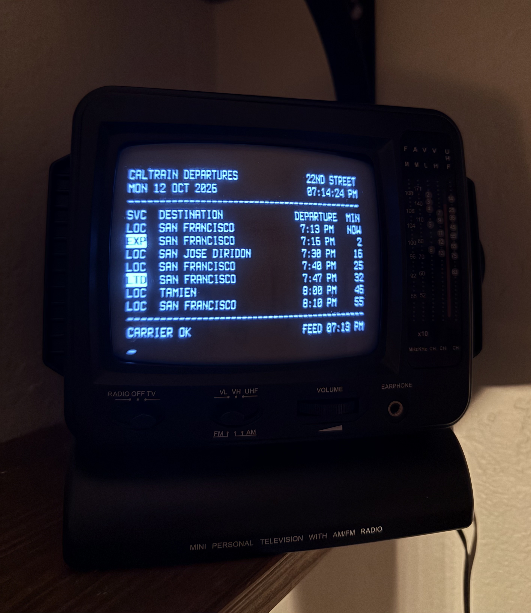

# caltrain-tty

<p align="center">
  
</p>

A live Caltrain departure board for a tiny CRT, styled like an old teletype.


## Running it

You'll need [Rust](https://rustup.rs).

```
cargo run
```

To pick a station, pass its platform IDs with `--stop`, once per platform:

```
cargo run -- --stop 70021 --stop 70022
```

Add `--once` to print a single page and exit.

## Raspberry Pi

On a Pi 3 or newer, you can build right on the device:

```bash
cargo build --release
sudo install -m 755 target/release/caltrain-tty /usr/local/bin/
```

A Pi Zero is too slow to compile Rust, so build it on another machine with [Zig](https://ziglang.org) and [cargo-zigbuild](https://github.com/rust-cross/cargo-zigbuild), then copy it over:

```bash
rustup target add arm-unknown-linux-gnueabihf
cargo zigbuild --release --target arm-unknown-linux-gnueabihf.2.36
```

```bash
scp target/arm-unknown-linux-gnueabihf/release/caltrain-tty pi@raspberrypi.local:
ssh pi@raspberrypi.local sudo install -m 755 caltrain-tty /usr/local/bin/
```

### Starting at boot

The board is sized for a 720×480 composite display using the Terminus Bold 32×16 console font. [`caltrain-tty-boot.sh`](caltrain-tty-boot.sh) sets that font and starts the board, and [`caltrain-tty.service`](caltrain-tty.service) runs it on the main screen in place of the login prompt.

Before installing, change `pi` in the service file to your username, and update the `--stop` flags in the boot script if you want a different station.

```bash
sudo apt install console-setup
echo 'pi ALL=(root) NOPASSWD: /usr/bin/setfont' | sudo tee /etc/sudoers.d/caltrain-tty
sudo install -m 755 caltrain-tty-boot.sh /usr/local/bin/caltrain-tty-boot
sudo install -m 644 caltrain-tty.service /etc/systemd/system/
sudo systemctl enable --now caltrain-tty.service
```

## License

[MIT](LICENSE)
